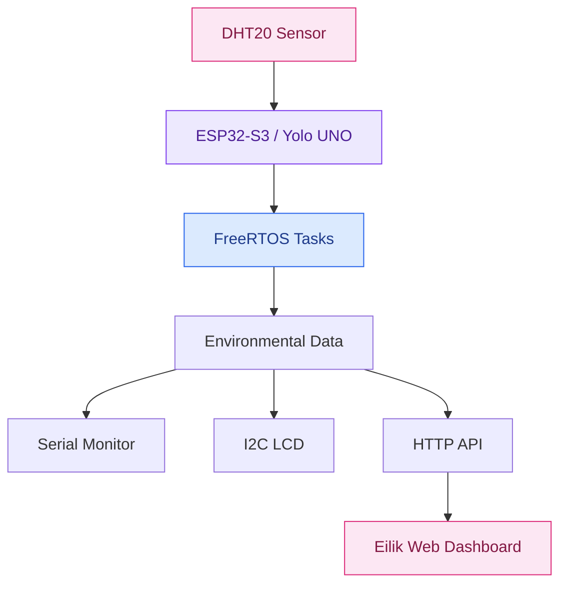

# 🌸 Eilik — Embedded Environmental Monitor

<p align="center">
  <strong>An interactive environmental monitoring dashboard powered by ESP32-S3 and FreeRTOS.</strong>
</p>

<p align="center">
  <a href="https://tutrita-03.github.io/Embedded-IoT-Monitoring-System/">
    
  </a>
  
  
  
  
</p>

---

## ✨ Overview

**Eilik Environmental Monitor** is an Embedded IoT project that combines microcontroller firmware, real-time task management, environmental sensing, and an interactive web interface.

The project uses an **ESP32-S3-based Yolo UNO board** as its embedded platform. The firmware is developed in C++, with FreeRTOS providing task-based execution. Environmental measurements from the DHT20 sensor can be displayed through serial output, an I²C LCD, and a web dashboard as the hardware-to-dashboard integration is completed.

The web interface takes inspiration from the expressive personality of Eilik, turning environmental monitoring into a more engaging and approachable experience.

### 🎯 Project Goals

- Develop practical C++ embedded firmware.
- Understand real-time task management with FreeRTOS.
- Interface with sensors and displays through I²C.
- Build an HTTP API for environmental data.
- Develop an interactive web dashboard.
- Connect embedded systems with web-based monitoring.

## 🚀 Live Demo

<p align="center">
  <a href="https://tutrita-03.github.io/Embedded-IoT-Monitoring-System/">
    
  </a>
</p>

**[Open Eilik Dashboard →](https://tutrita-03.github.io/Embedded-IoT-Monitoring-System/)**

The GitHub Pages version allows visitors to explore the dashboard UI using simulated sensor readings. It does not directly connect to the physical ESP32-S3 board.

When accessed through the board's local web server, the intended hardware workflow is to retrieve environmental measurements from the firmware API.

> **Demo vs. hardware:** The online demo uses simulated readings. Real sensor data requires the ESP32-S3 / Yolo UNO firmware, sensor hardware, and local network connection to be running.

## 🧩 System Architecture



### Data Flow

1. **Sensing:** The DHT20 measures ambient temperature and relative humidity.
2. **Processing:** The ESP32-S3 firmware manages application logic and sensor data.
3. **Real-time execution:** FreeRTOS tasks organize firmware responsibilities.
4. **Local output:** Measurements can be inspected through the serial monitor and displayed on an I²C LCD.
5. **Web service:** The embedded web server exposes environmental status through `/api/status`.
6. **Visualization:** The Eilik dashboard provides the web-based monitoring interface.

## 🛠️ Technology Stack

| Category | Technologies |
|---|---|
| Embedded language | C++ |
| Microcontroller | ESP32-S3 / Yolo UNO |
| Development environment | VS Code, PlatformIO |
| Real-time operating system | FreeRTOS |
| Sensor | DHT20 |
| Display | I²C LCD1602 |
| Communication | I²C, Wi-Fi, HTTP |
| Web server | ESP32 WebServer |
| Filesystem | LittleFS |
| Frontend | HTML, CSS, JavaScript |
| Version control | Git, GitHub |

## 🌷 Dashboard Features

- Interactive Eilik-inspired user interface.
- Animated character expressions and visual feedback.
- Multiple interactive screens and navigation.
- Clock and conversational UI demonstrations.
- Japanese speech synthesis with Vietnamese subtitles, where supported by the browser.
- Responsive web interface.
- Simulated environmental values for the online demo.
- Firmware API endpoint designed to provide environmental status.

> Some visual indicators and conversational features are UI demonstrations. Simulated online readings should not be interpreted as measurements from a physical sensor.

## ⚙️ Embedded Firmware

The firmware is developed for the ESP32-S3-based Yolo UNO board using PlatformIO.

### Current implementation

- C++ firmware project with a modular source layout.
- FreeRTOS task-based application structure.
- DHT20 sensor support.
- I²C LCD integration.
- Embedded HTTP server and static web assets served through LittleFS.
- `/api/status` endpoint for environmental status.
- Serial logging for development and debugging.

### API Endpoint

```http
GET /api/status
```

The endpoint returns JSON describing sensor availability, Wi-Fi status, temperature, humidity, and environmental status.

Example response structure:

```json
{
  "available": true,
  "sensorAvailable": true,
  "wifiConnected": true,
  "temperature": 28.5,
  "humidity": 65.0,
  "status": "online",
  "environmentStatus": "normal"
}
```

The values above are illustrative; actual responses depend on the running firmware and sensor readings.

## 📁 Project Structure

```text
YOLOboard--Project/
├── data/
│   ├── eliko.html
│   ├── style.css
│   └── app.js
├── docs/
│   ├── index.html
│   ├── style.css
│   └── app.js
├── include/
│   ├── AppConfig.h
│   ├── AppTasks.h
│   ├── DHT20Sensor.h
│   ├── EnvironmentMonitor.h
│   └── WebServerManager.h
├── src/
│   ├── main.cpp
│   ├── AppTasks.cpp
│   ├── DHT20Sensor.cpp
│   ├── EnvironmentMonitor.cpp
│   └── WebServerManager.cpp
├── platformio.ini
└── README.md
```

- `src/`: Firmware implementation.
- `include/`: Application headers and module interfaces.
- `data/`: Static assets served by the ESP32 through LittleFS.
- `docs/`: Website files published through GitHub Pages.
- `platformio.ini`: PlatformIO project and build configuration.

## 🔧 Getting Started

### Requirements

- ESP32-S3-based Yolo UNO board.
- USB data cable.
- VS Code with the PlatformIO extension.
- DHT20 sensor and compatible I²C LCD1602 for hardware testing.
- Wi-Fi access for network features.

### 1. Clone the repository

```bash
git clone https://github.com/TuTriTa-03/YOLOboard--Project.git
cd YOLOboard--Project
```

### 2. Open the firmware project

Open the project in VS Code and allow PlatformIO to install the configured dependencies.

### 3. Configure the hardware and network

Review the project configuration and source files for the correct board, I²C pins, sensor connections, and Wi-Fi settings.

**Security:** Do not commit real Wi-Fi passwords, MQTT credentials, or access tokens to a public repository. Keep secrets in a local configuration file excluded from Git.

### 4. Build and upload firmware

From the PlatformIO terminal:

```bash
pio run
pio run -t upload
```

### 5. Upload the web assets

```bash
pio run -t uploadfs
```

### 6. Monitor serial output

```bash
pio device monitor -b 115200
```

After connecting the board to Wi-Fi, open the board's local IP address in a browser to access the embedded web interface. The board must be powered on and reachable over the local network.

## 🗺️ Roadmap

- [x] Create the Eilik-inspired web dashboard.
- [x] Publish the dashboard through GitHub Pages.
- [x] Develop the ESP32-S3 firmware project structure.
- [x] Implement the environmental status API.
- [x] Integrate the DHT20 sensor and I²C LCD.
- [x] Establish the FreeRTOS-based application structure.
- [ ] Complete and validate live sensor updates in the ESP32-served dashboard.
- [ ] Improve error handling for sensor and Wi-Fi failures.
- [ ] Add environmental history and measurement charts.
- [ ] Improve firmware testing and documentation.
- [ ] Explore MQTT-based remote monitoring.

## 📚 What I'm Learning

This project is part of my learning journey in:

- Embedded C/C++ development.
- FreeRTOS and real-time application design.
- Microcontroller peripherals and I²C communication.
- Wi-Fi networking and HTTP APIs.
- Firmware modularization and debugging.
- Embedded-to-web system integration.

## 👨‍💻 Author

**Thái Tuấn**

Embedded Systems | C++ | IoT | Edge AI

Building intelligent systems that connect software with the real world.

- GitHub: [@TuTriTa-03](https://github.com/TuTriTa-03)
- Project repository: [YOLOboard--Project](https://github.com/TuTriTa-03/YOLOboard--Project)
- Live demo: [Eilik Environmental Monitor](https://tutrita-03.github.io/Embedded-IoT-Monitoring-System/)

---

<p align="center">
  <i>From firmware to interface — making embedded systems more interactive.</i>
</p>
